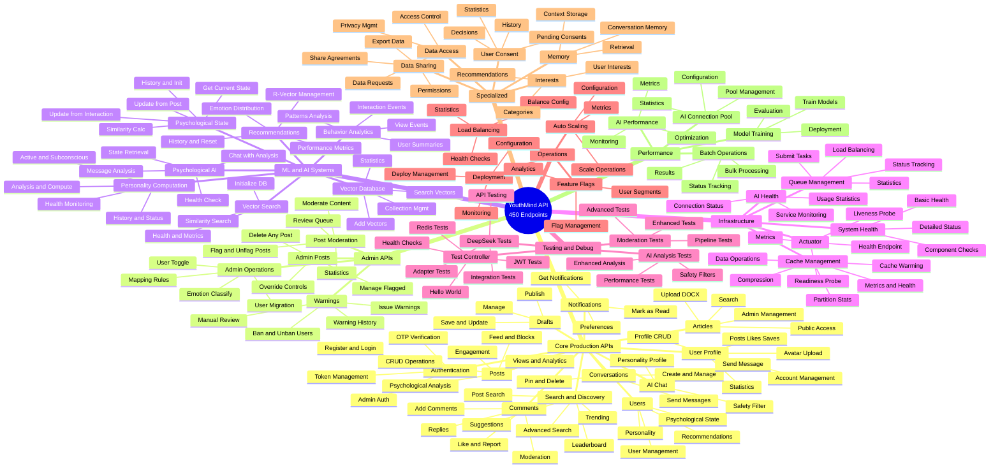

# YouthMind API Endpoint Mind Map

**Visual Overview of All ~450 API Endpoints**

---

## 🗺️ Interactive Mind Map (Mermaid)



---

## 📊 Text-Based Mind Map

```
YouthMind API (~450 Endpoints)
│
├─── 🔐 CORE PRODUCTION APIS (~120 endpoints) ✅ ESSENTIAL
│    │
│    ├─── Authentication (/v1/auth) - 9 endpoints
│    │    ├─ POST /send-otp
│    │    ├─ POST /register
│    │    ├─ POST /login
│    │    ├─ POST /refresh-token
│    │    ├─ POST /logout
│    │    ├─ POST /admin/register
│    │    ├─ POST /admin/login
│    │    ├─ POST /admin/revoke-token
│    │    └─ GET  /test
│    │
│    ├─── Posts (/v1/posts) - 17 endpoints
│    │    ├─ POST   /create
│    │    ├─ GET    / (all posts)
│    │    ├─ GET    /feed
│    │    ├─ GET    /feed/blocks ⭐ Personalized
│    │    ├─ GET    /by-user/{userId}
│    │    ├─ GET    /{id}
│    │    ├─ PUT    /{id} (update)
│    │    ├─ DELETE /{id}
│    │    ├─ PUT    /{id}/resonance (like)
│    │    ├─ PUT    /{id}/collect (save)
│    │    ├─ POST   /{id}/view
│    │    ├─ POST   /{id}/view/duration
│    │    ├─ POST   /{id}/view/start (deprecated)
│    │    ├─ POST   /{id}/view/end (deprecated)
│    │    ├─ GET    /{id}/view-stats
│    │    ├─ POST   /{id}/analyze-psychological
│    │    └─ GET    /{id}/psychological-metadata
│    │
│    ├─── Comments (/v1/posts) - 6 endpoints
│    │    ├─ GET    /{postId}/comments
│    │    ├─ POST   /{postId}/comments
│    │    ├─ POST   /comments/{commentId}/replies
│    │    ├─ DELETE /comments/{commentId}
│    │    ├─ PUT    /comments/{commentId}/like
│    │    └─ POST   /comments/{commentId}/report
│    │
│    ├─── Users (/api/users) ⚠️ VERSION ISSUE - 10 endpoints
│    │    ├─ GET    / (all users - admin)
│    │    ├─ GET    /{id}
│    │    ├─ GET    /email/{email}
│    │    ├─ DELETE /{id}
│    │    ├─ GET    /personality/{userId}
│    │    ├─ POST   /personality/compute
│    │    ├─ GET    /personality/insights/{userId}
│    │    ├─ GET    /{userId}/psychological-state
│    │    ├─ PUT    /{userId}/recommendation-engine
│    │    └─ GET    /{userId}/recommendation-engine
│    │
│    ├─── User Profile (/v1/user) - 9 endpoints
│    │    ├─ GET    /profile
│    │    ├─ PUT    /profile
│    │    ├─ GET    /posts
│    │    ├─ GET    /liked-posts
│    │    ├─ GET    /saved-posts
│    │    ├─ GET    /statistics
│    │    ├─ POST   /avatar
│    │    ├─ DELETE /account
│    │    └─ PUT    /settings/recommendation-engine
│    │
│    ├─── Search & Discovery (/v1) - 7 endpoints
│    │    ├─ GET /search/posts
│    │    ├─ GET /search/posts/advanced
│    │    ├─ GET /search/posts/emotion/{emotion}
│    │    ├─ GET /trending
│    │    ├─ GET /leaderboard
│    │    ├─ GET /suggestions
│    │    └─ GET /trending-topics
│    │
│    ├─── Notifications (/v1/notifications) - 3 endpoints
│    │    ├─ GET  /
│    │    ├─ POST /{notificationId}/read
│    │    └─ POST /read-all
│    │
│    ├─── Conversations (/v1/conversations) - 6 endpoints
│    │    ├─ GET    /
│    │    ├─ POST   /
│    │    ├─ GET    /{conversationId}
│    │    ├─ POST   /{conversationId}/messages
│    │    ├─ DELETE /{conversationId}
│    │    └─ PUT    /{conversationId}/pin
│    │
│    ├─── AI Chat (/v1/ai-chat) - 4 endpoints
│    │    ├─ POST /send-message
│    │    ├─ GET  /personality-profile
│    │    ├─ PUT  /personality-profile
│    │    └─ POST /test-safety-filter
│    │
│    ├─── Drafts (/v1/drafts) - 5 endpoints
│    │    ├─ GET    /
│    │    ├─ POST   /
│    │    ├─ PUT    /{draftId}
│    │    ├─ DELETE /{draftId}
│    │    └─ POST   /{draftId}/publish
│    │
│    └─── Articles (/v1/articles) - 9 endpoints
│         ├─ GET    / (public)
│         ├─ GET    /admin (admin only)
│         ├─ GET    /view/{id}
│         ├─ POST   /create
│         ├─ PUT    /edit/{id}
│         ├─ DELETE /delete/{id}
│         ├─ POST   /manage/{id}/toggle-publish
│         ├─ GET    /search
│         └─ POST   /upload-docx
│
├─── 👨‍💼 ADMIN APIS (~80 endpoints) ✅ ESSENTIAL
│    │
│    ├─── Admin Operations (/admin/v1) - 7 endpoints
│    │    ├─ PUT  /users/{userId}/recommendation-toggle
│    │    ├─ GET  /users/{userId}/recommendation-status
│    │    ├─ POST /posts/classify-emotions
│    │    ├─ POST /users/migrate
│    │    ├─ GET  /recommendationmapping/rules
│    │    ├─ GET  /recommendationmapping/rules/{id}
│    │    └─ PUT  /recommendationmapping/rules/{id}
│    │
│    ├─── Post Moderation (/api/moderation/posts) ⚠️ VERSION - 5 endpoints
│    │    ├─ POST /moderate/{postId}
│    │    ├─ GET  /flagged
│    │    ├─ POST /unflag/{postId}
│    │    ├─ POST /flag/{postId}
│    │    └─ GET  /statistics
│    │
│    ├─── Admin Posts (/admin/v1/posts) 🔄 REDUNDANT - 4 endpoints
│    │    ├─ DELETE /delete/{postId}
│    │    ├─ GET    /flagged
│    │    ├─ POST   /flag/{postId}
│    │    └─ POST   /unflag/{postId}
│    │
│    └─── Warning System (/api/warnings) ⚠️ VERSION - 8 endpoints
│         ├─ POST /issue
│         ├─ GET  /user/{userId}
│         ├─ POST /{warningId}/acknowledge
│         ├─ POST /ban/{userId}
│         ├─ POST /unban/{userId}
│         ├─ GET  /user/{userId}/banned
│         ├─ GET  /user/{userId}/status
│         └─ GET  /manual-review
│
├─── 🤖 ML & AI SYSTEMS (~100 endpoints) 🟡 MIXED
│    │
│    ├─── Recommendation Engine (/v1/recommendation) ✅ - 5 endpoints
│    │    ├─ GET  /rvector
│    │    ├─ GET  /rvector/history
│    │    ├─ POST /rvector/reset
│    │    ├─ GET  /analytics/recommendation/performance
│    │    └─ GET  /analytics/recommendation/emotion-distribution
│    │
│    ├─── Psychological State (/api/psychological-state) ⚠️ - 7 endpoints
│    │    ├─ POST /update-from-post
│    │    ├─ POST /update-from-interaction
│    │    ├─ GET  /current/{userId}
│    │    ├─ POST /similarity
│    │    ├─ GET  /history/{userId}
│    │    ├─ POST /initialize/{userId}
│    │    └─ POST /vector-operations
│    │
│    ├─── Psychological AI Chat (/api/ai/psychology) ⚠️ - 4 endpoints
│    │    ├─ POST /chat/{userId}
│    │    ├─ GET  /state/{userId}
│    │    ├─ POST /analyze/{userId}
│    │    └─ GET  /health
│    │
│    ├─── Behavior Analytics (/v1/analytics/behavior) 🔵 - 4 endpoints
│    │    ├─ POST /view
│    │    ├─ POST /interaction
│    │    ├─ GET  /summary/{userId}
│    │    └─ GET  /patterns/{userId}
│    │
│    ├─── Personality Computation (/api/personality) 🗑️ UNUSED - 9 endpoints
│    │    ├─ GET  /analysis/{userId}
│    │    ├─ GET  /active/{userId}
│    │    ├─ GET  /subconscious/{userId}
│    │    ├─ GET  /fused/{userId}
│    │    ├─ POST /compute/{userId}
│    │    ├─ POST /schedule/{userId}
│    │    ├─ GET  /history/{userId}
│    │    ├─ GET  /status/{userId}
│    │    └─ GET  /health
│    │
│    ├─── Vector Search (/v1/vector-search) 🔵 INTERNAL - 4 endpoints
│    │    ├─ POST /search
│    │    ├─ GET  /health
│    │    ├─ GET  /metrics
│    │    └─ POST /initialize
│    │
│    └─── Vector Database (/api/vector-db) ⚠️ 🔵 - 6 endpoints
│         ├─ POST /initialize
│         ├─ GET  /health
│         ├─ GET  /collections/{name}/stats
│         ├─ POST /collections/{name}/search
│         ├─ POST /collections/{name}/vectors
│         └─ POST /test
│
├─── 🏗️ INFRASTRUCTURE (~50 endpoints) 🟡 MIXED
│    │
│    ├─── System Health (/v1/health) ✅ - 2 endpoints
│    │    ├─ GET /
│    │    └─ GET /detailed
│    │
│    ├─── Actuator (/actuator) ✅ - 4 endpoints
│    │    ├─ GET /health
│    │    ├─ GET /health/liveness
│    │    ├─ GET /health/readiness
│    │    └─ GET /metrics
│    │
│    ├─── AI Health (/v1/ai-health) ✅ - 3 endpoints
│    │    ├─ GET /
│    │    ├─ GET /connection-status
│    │    └─ GET /usage-stats
│    │
│    ├─── Queue Management (/v1/queue) ✅ - 5 endpoints
│    │    ├─ POST /submit
│    │    ├─ GET  /status/{requestId}
│    │    ├─ GET  /statistics
│    │    ├─ GET  /processing-times
│    │    └─ POST /load-balance
│    │
│    └─── Cache Management (/v1/cache) 🗑️ TOO MANY - ~20 endpoints
│         ├─ GET    /metrics
│         ├─ GET    /health
│         ├─ GET    /data/{key}
│         ├─ POST   /data/{key}
│         ├─ DELETE /data/{key}
│         ├─ DELETE /data/pattern/{pattern}
│         ├─ GET    /partitions/performance
│         ├─ GET    /partitions/statistics
│         └─ ... (12 more)
│
├─── 🧪 TESTING & DEBUG (~50 endpoints) 🔴 REMOVE
│    │
│    ├─── Test Controller (/api/test) 🗑️ - 7 endpoints
│    │    ├─ GET  /hello
│    │    ├─ GET  /health
│    │    ├─ GET  /redis
│    │    ├─ GET  /redis/cache
│    │    ├─ POST /redis/pubsub
│    │    ├─ GET  /redis/hot-posts
│    │    └─ GET  /redis/jwt-token
│    │
│    ├─── DeepSeek API Test 🗑️ - ~10 endpoints
│    ├─── DeepSeek Adapter Test 🗑️ - ~5 endpoints
│    ├─── Enhanced Moderation Test 🗑️ - ~8 endpoints
│    ├─── Advanced Moderation Test 🗑️ - ~8 endpoints
│    └─── Enhanced AI Analysis Test 🗑️ - ~10 endpoints
│
├─── ⚙️ OPERATIONS (~40 endpoints) 🗑️ MOVE TO CI/CD
│    │
│    ├─── Deployment (/v1/deployment) - ~10 endpoints
│    ├─── Deployment Monitoring - ~8 endpoints
│    ├─── Deployment Configuration - ~12 endpoints
│    ├─── Auto Scaling (/v1/auto-scaling) - ~10 endpoints
│    ├─── Load Balancing - ~8 endpoints
│    ├─── Feature Flags (/v1/feature-flags) - ~10 endpoints
│    └─── Feature Flag Analytics - ~8 endpoints
│
├─── 🔧 SPECIALIZED (~80 endpoints) 🗑️ MOSTLY UNUSED
│    │
│    ├─── User Consent (/v1/consent) 🗑️ - 6 endpoints
│    │    ├─ GET  /pending
│    │    ├─ GET  /history
│    │    ├─ POST /{consentId}/decision
│    │    ├─ GET  /check/{contentId}
│    │    ├─ GET  /statistics
│    │    └─ GET  /alternatives/{word}
│    │
│    ├─── Interests (/v1/interests) 🗑️ - ~6 endpoints
│    ├─── Memory Management (/v1/memory) 🔵 - ~8 endpoints
│    ├─── Psychological Data Access 🗑️ - ~15 endpoints
│    └─── Data Sharing (/api/data-sharing) 🗑️ - ~10 endpoints
│
└─── ⚡ PERFORMANCE (~30 endpoints) 🔵 INTERNAL
     │
     ├─── AI Connection Pool - ~10 endpoints
     ├─── AI Service Extensions - ~8 endpoints
     ├─── AI Performance - ~10 endpoints
     ├─── Batch Operations (/v1/batch) - ~8 endpoints
     ├─── Interaction Processing - ~8 endpoints
     └─── Model Training - ~10 endpoints
```

---

## 📈 Summary Statistics by Category

| Category | Endpoints | Status | Action |
|----------|-----------|--------|--------|
| **Core Production** | ~120 | ✅ Essential | Keep All |
| **Admin APIs** | ~80 | ✅ Essential | Keep, Consolidate Some |
| **ML & AI Systems** | ~100 | 🟡 Mixed | Keep Used, Review Unused |
| **Infrastructure** | ~50 | 🟡 Mixed | Keep Health/Monitoring Only |
| **Testing & Debug** | ~50 | 🔴 Remove | Delete All from Production |
| **Operations** | ~40 | 🗑️ Remove | Move to CI/CD |
| **Specialized** | ~80 | 🗑️ Unused | Remove Unimplemented |
| **Performance** | ~30 | 🔵 Internal | Keep Internal Only |
| **TOTAL** | **~450** | | **Target: ~200** |

---

## 🎯 Color-Coded Legend

- ✅ **ESSENTIAL** - Core functionality, must keep
- 🟡 **MIXED** - Some used, some not, review needed
- 🔵 **INTERNAL** - Used internally, not by frontends
- 🗑️ **UNUSED** - No frontend usage, remove
- 🔴 **REMOVE** - Test/debug, remove immediately
- 🔄 **REDUNDANT** - Duplicate functionality
- ⚠️ **VERSION ISSUE** - Uses /api/ instead of /v1/

---

## 🔍 Quick Insights from Mind Map

### What Stands Out:

1. **Testing Bloat** 🔴
   - 50+ test endpoints exposed in production
   - 5 separate test controllers
   - Should be in test package, not production

2. **Operations Misplaced** 🗑️
   - 40+ deployment/scaling endpoints in API
   - Should be handled by CI/CD and Kubernetes
   - Not appropriate for REST API

3. **Unused Features** 🗑️
   - User Consent (not implemented in any frontend)
   - Interests (not implemented)
   - Data Sharing (not implemented)
   - ~80 endpoints for unimplemented features

4. **Version Inconsistency** ⚠️
   - Users: `/api/users` should be `/v1/users`
   - Moderation: `/api/moderation` should be `/admin/v1/moderation`
   - Warnings: `/api/warnings` should be `/v1/warnings` or `/admin/v1/warnings`
   - Psychological State: `/api/psychological-state` should be `/v1/psychological-state`
   - ~30 endpoints need migration

5. **Duplicate Functionality** 🔄
   - AdminPostController overlaps with PostModerationController
   - AIChatController overlaps with AIChatApiController
   - Multiple personality endpoints across different controllers

### Frontend Usage:

**iOS App Uses** (~30 endpoints):
- ✅ Authentication (5)
- ✅ Posts (10)
- ✅ Feed & Search (5)
- ✅ Conversations (6)
- ✅ AI Chat (1)
- ✅ R-Vector (1)
- ❌ Comments (not implemented)
- ❌ Notifications (not implemented)
- ❌ User Profile (not implemented)
- ❌ Drafts (not implemented)

**Admin Panel Uses** (~50 endpoints):
- ✅ Authentication (2)
- ✅ User Management (4)
- ✅ Post Management (7)
- ✅ Article Management (9)
- ✅ Psychological Analysis (8)
- ✅ System Health (5)
- ✅ R-Vector Management (3)
- ✅ Analytics (8)
- ✅ Mapping Rules (3)

**Total Used: ~90 endpoints (20%)**
**Unused: ~360 endpoints (80%)**

---

## 💡 How to Use This Mind Map

1. **For Understanding**: See the full API structure at a glance
2. **For Prioritization**: Focus on ✅ Essential sections first
3. **For Cleanup**: Target 🔴 Remove and 🗑️ Unused sections
4. **For Testing**: Use as checklist when testing in Swagger UI
5. **For Frontend Dev**: Identify available endpoints for features

---

## 📱 Frontend Feature Opportunities

Backend ready but iOS not using:
- **Comments** (6 endpoints) - High value social feature
- **Notifications** (3 endpoints) - Critical for engagement
- **User Profile** (9 endpoints) - Essential user experience
- **Drafts** (5 endpoints) - Nice to have

**Total Opportunity**: 23 ready-to-use endpoints that could improve iOS app!

---

**Visual Tip**: The Mermaid diagram at the top renders as an interactive mind map in GitHub, VS Code with Mermaid extension, or any Mermaid-compatible viewer!

