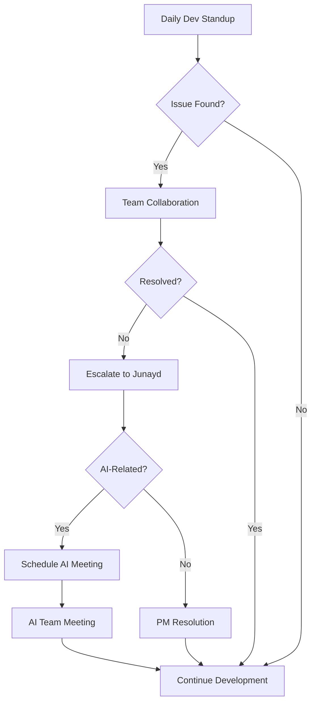

# YouthMind: Team Coordination & Meeting Structure

*A clear framework for team coordination, daily standups, and progress tracking to ensure smooth development workflow*

---

## 1. Team Meeting Structure

### Daily Development Standups

**Participants**: All team members **EXCEPT** Kevin and Andy
- **iOS Team**: Dawei, Dexter, Youssef
- **Backend Team**: Mustafo, Ahmed, Harley
- **Admin Dashboard**: Alex
- **Project Manager**: Junayd (facilitator)

**Meeting Details**:
- **Frequency**: Daily (time adjustable based on team availability)
- **Duration**: Flexible
- **Format**: Stand-up style (brief updates, not deep technical discussions)

**Agenda Structure**:
1. **Yesterday's Progress** 
   - What did you complete?
   - Any blockers encountered?
   
2. **Today's Focus** 
   - What are you working on today?
   - Expected deliverables?
   
3. **Coordination & Dependencies** 
   - Cross-team integration needs
   - API contract changes
   - Shared component updates
   
4. **Issue Resolution**
   - Technical blockers requiring team input
   - Design decisions affecting multiple components
   - Timeline adjustments needed

**Why Kevin and Andy are Excluded**:
- Kevin and Andy focus exclusively on **AI/ML algorithms and models**
- They **cannot provide answers** about frontend or backend integration
- Their work is primarily research and model development, separate from application development

---

### AI Team Coordination Meetings

**Participants**: Junayd (Project Manager), Kevin (AI Lead), Andy (AI Developer)

**Meeting Details**:
- **Frequency**: Every 2-3 days (flexible based on AI development progress)
- **Duration**: 30-45 minutes
- **Purpose**: AI-specific coordination and integration planning

**Agenda Structure**:
1. **AI Development Progress** 
   - Model training status and performance metrics
   - Algorithm improvements and testing results
   - Technical challenges in AI pipeline
   
2. **Integration Requirements**
   - API endpoint changes needed from AI service
   - New AI features ready for backend integration
   - Performance requirements and scaling considerations
   
3. **Task Assignment & Priorities**
   - Next sprint AI deliverables
   - Research tasks vs. implementation tasks
   - Timeline alignment with app development milestones

4. **Communication to Main Team** 
   - What updates need to be shared with the development team?
   - Any changes affecting backend API integration?

---

## 2. Task Management & Tracking

### Notion Workspace Organization

**Project Manager Responsibilities** (Junayd):
- **Task Assignment**: All team members receive tasks through Notion
- **Progress Tracking**: Individual contributions monitored via Notion updates
- **Sprint Planning**: Weekly sprint goals and deliverables defined in Notion
- **Dependency Management**: Cross-team dependencies tracked and resolved

### Notion Board Structure

#### **Development Teams Board**
```
📋 Backlog | 🔄 In Progress | 👀 Review | ✅ Done | 🚫 Blocked

Cards include:
- Assignee(s)
- Story points/time estimate
- Dependencies
- Acceptance criteria
- Labels (iOS/Backend/Admin/Integration)
```

#### **AI Team Board** 
```
🔬 Research | 🛠️ Development | 🧪 Testing | 📊 Integration | ✅ Complete

Cards include:
- Model/algorithm focus
- Performance targets
- Integration requirements
- Research findings
```

#### **Integration Tracking Board**
```
📱 iOS Ready | ⚙️ Backend Ready | 🤖 AI Ready | 🔗 Integration | 🚀 Deployed

Cross-team features requiring coordination
```

---

## 3. Communication Protocols

### Issue Escalation Process

**Level 1: Peer Collaboration**
- Team members work together to solve technical issues
- Use daily standup for quick problem-solving
- Pair programming encouraged for complex problems

**Level 2: Project Manager Intervention**
- Issues that affect timeline or cross-team dependencies
- Junayd facilitates resolution and adjusts priorities
- Resource reallocation if needed

**Level 3: AI Team Consultation**
- Issues specifically related to AI integration or algorithm performance
- Scheduled discussion in next AI coordination meeting
- Not for general app development questions

### Knowledge Boundaries

**What Kevin and Andy CAN Help With**:
- AI model performance and accuracy
- Sentiment analysis algorithm improvements
- Question generation logic and templates
- AI service API design and optimization
- Machine learning model deployment

**What Kevin and Andy CANNOT Help With**:
- iOS UI implementation and SwiftUI issues
- Backend API development and Spring Boot configuration
- Database schema design and optimization
- React admin dashboard development
- General application architecture questions
- User experience and design decisions

### Daily Communication Flow



---

## 4. Weekly Coordination Cycle

### Monday: Sprint Planning
- **Morning**: Junayd reviews Notion boards and assigns weekly tasks
- **Afternoon**: Development team standup with weekly goals review

### Tuesday-Thursday: Development & Daily Standups
- **Daily**: development team standup
- **As Needed**: AI team meetings (2-3 times per week)

### Friday: Sprint Review & Planning
- **Morning**: Demo/review of completed features
- **Afternoon**: Sprint retrospective and next week planning
- **AI Update**: Kevin/Andy present progress to full team (if significant updates)

---

## 5. Progress Tracking Metrics

### Individual Contribution Tracking
**Measured via Notion**:
- Tasks completed per sprint
- Story points delivered
- Code review participation
- Blocker resolution contribution
- Cross-team collaboration instances

### Team Performance Metrics
- Sprint velocity and completion rate
- Bug discovery and resolution time
- Integration success rate
- Feature delivery timeline adherence

### AI Team Specific Metrics
- Model performance improvements
- API response time optimization
- Integration milestone completion
- Research findings documentation

---

## 6. Meeting Schedule Template

### Daily Development Standup
```
📅 Time: [To be determined based on team availability]
⏰ Duration: Flexible
👥 Attendees: Dawei, Dexter, Youssef, Mustafo, Ahmed, Harley, Alex, Junayd

Structure:
1. Quick round-robin updates (10 min)
2. Cross-team coordination (5 min)
3. Issue identification (5 min)
```

### AI Coordination Meeting
```
📅 Time: Every 2-3 days (flexible)
⏰ Duration: Subject to the updates  
👥 Attendees: Junayd, Kevin, Andy

Structure:
1. AI progress review (15 min)
2. Integration planning (15 min)
3. Task assignment (10 min)
4. Communication planning (5 min)
```

---

## 7. Success Indicators

### Effective Coordination Signs
- ✅ Daily standups completed within time limit
- ✅ Issues resolved collaboratively without escalation
- ✅ Cross-team dependencies identified and managed proactively
- ✅ AI integration milestones met on schedule
- ✅ All team members actively contributing via Notion tracking

### Communication Quality Metrics
- Reduced time to resolve technical blockers
- Fewer integration surprises and conflicts
- Improved sprint completion rates
- Clear separation of concerns between AI and app development
- Efficient knowledge sharing within appropriate team boundaries

---

*This coordination structure ensures efficient daily development progress while maintaining clear boundaries between AI research/development and application implementation, with Junayd serving as the central coordinator and communication bridge between teams.* 