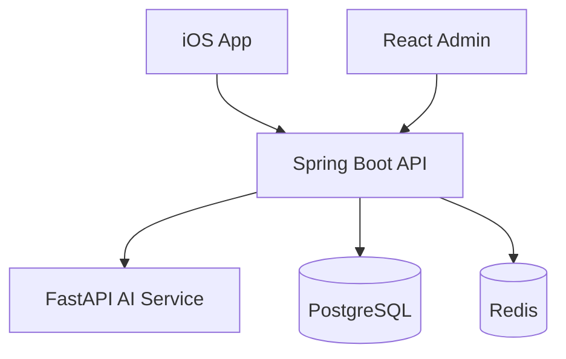

# YouthMind: High-Level Technical Architecture & Technology Stack

*A clear, concise overview of the technology choices and component interactions for building YouthMind*

Below is a comprehensive guide focusing on which technologies to use, how each part fits together, and who on the team is responsible. The UI designs and team composition are already finalized—this guide focuses on the technical implementation strategy.

---

## 1. Core Components & Their Responsibilities

### iOS Mobile App (SwiftUI)

**Purpose**: Provides the user interface for anonymous posting, feed browsing, AI-driven sentiment insights, emotion museum, avatar/cover creation, and notifications.

**Technology**: Swift 5.5+ with SwiftUI (MVVM architecture, Combine for reactive flows).

**Team**: Dawei, Dexter, Youssef.

**Key Features**:
- Anonymous user session management
- Real-time feed with infinite scroll
- Post creation with emotion selection
- Avatar/cover design tools
- Emotion museum visualization
- Push notifications integration

---

### Backend API (Spring Boot)

**Purpose**: Exposes REST endpoints for user sessions, posts (create/read/delete), comments/resonances, drafts (optional), and admin moderation. Orchestrates communication with the AI service.

**Technology**: Java 17+ with Spring Boot 3.x (Spring Security for JWT authentication, Spring Data JPA for PostgreSQL).

**Team**: Mustafo (API architecture), Junayd (system design/PM), Ahmed (database), Harley (caching & security).

**Key Features**:
- RESTful API with OpenAPI documentation
- JWT-based authentication
- PostgreSQL data persistence
- Redis caching integration
- AI service orchestration
- Admin endpoints for content moderation

---

### AI Microservice (FastAPI)

**Purpose**: Hosts all machine-learning capabilities—sentiment analysis, follow-up question generation, emotion classification, and post summarization.

**Technology**: Python 3.9+ with FastAPI (HuggingFace Transformers / PyTorch), containerized via Docker.

**Team**: Andy (models/NLP), Kevin (AI Lead).

**Key Features**:
- Real-time sentiment analysis
- Emotion-based question generation
- Content summarization
- Empathy scoring algorithms
- Model versioning and A/B testing support

---

### Admin Web Dashboard (React SPA)

**Purpose**: Allows moderators to view flagged content, delete inappropriate posts, and manage basic metrics and user accounts.

**Technology**: React (JavaScript/TypeScript) with a lightweight UI library (e.g., Tailwind CSS or Material-UI).

**Team**: Alex (full-stack).

**Key Features**:
- Content moderation interface
- Real-time statistics dashboard
- User management tools
- Flagged post review system
- Admin authentication and authorization

---

### Database & Caching

**PostgreSQL**: Stores all relational data (users, posts, comments, resonances, AI metadata, notifications, drafts).

**Redis**: Acts as a cache for feed paging and search results, and as a fast counter store for resonance counts or "hot posts."

**Team**: Ahmed (schema design & optimization), Harley (Redis configuration & caching strategy).

**Key Features**:
- JSONB columns for flexible data storage
- Full-text search capabilities
- Optimized indexing strategy
- Redis TTL-based caching
- Pub/Sub for real-time notifications

---

### Infrastructure & DevOps

**Docker Compose**: For local development (PostgreSQL, Redis, backend, AI service, admin dashboard).

**Kubernetes** (or managed container service): For staging/production—deploy backend and AI microservices with autoscaling, TLS termination via an Ingress.

**CI/CD (GitHub Actions)**: Automate builds/tests for mobile, backend, AI, and admin code; push Docker images; deploy to staging/production.

**Team**: Junayd (pipeline coordination), Ahmed & Harley (database & infrastructure), Alex (admin deployment scripts).

---

## 2. High-Level Data Flow

### User Session & Identity

1. **Anonymous Browsing**: New users can immediately view the feed and browse posts without any registration via `GET /posts/feed` (no authentication required)
2. **Registration Required for Interaction**: To create posts, add comments, give resonances, or access personal features, users must register with email or phone via `POST /auth/register`
3. **Anonymous Registration**: 
   - Backend generates a UUID for the user and stores email/phone for authentication only
   - No personally identifiable information is ever displayed or associated with posts
   - User receives a JWT token for all subsequent authenticated interactions
4. **Session Management**: iOS app stores the JWT in iOS Keychain for authenticated features while allowing anonymous browsing

### Creating a New Post

1. **Authentication Check**: Ensure user is registered and has valid JWT token; redirect to registration if not authenticated
2. **User Input**: User composes title, content, selects emotion tag, and optionally picks avatar/cover
3. **API Call**: iOS calls `POST /posts/create` on backend, including JWT and post data
4. **Backend Processing**:
   - Validates JWT (Spring Security) and confirms user registration
   - Persists basic Post record to PostgreSQL with anonymous user UUID (no PII exposure)
   - Calls AI microservice (`POST /ai/sentiment`, `POST /ai/questions`) to compute:
     - Sentiment score
     - Empathy score
     - Follow-up questions
   - Stores AI metadata in separate AI-data table
   - Sends back combined PostDto to iOS client
5. **Cache Update**: Redis invalidates or updates cached feed pages so new post appears at top

### Browsing the Feed

1. **Request**: iOS app requests `GET /posts/feed?page=X&size=Y` (including JWT)
2. **Backend Processing**:
   - Checks Redis cache for `feed:X:Y`
   - If cache miss: queries PostgreSQL for recent posts, assembles PostDto objects (including AI fields), stores result in Redis with 5–10 minute TTL
   - Returns paginated PostDto array and hasNext flag
3. **Display**: iOS displays posts in SwiftUI List or LazyVStack, coloring each card's border based on emotion field

### Emotion Museum (User History)

1. **Request**: iOS "Emotion Museum" screen calls `GET /posts/user/{userId}` to fetch all posts by that user
2. **Backend**: Retrieves all posts for userId (sorted ascending by creation date) and includes emotion tags
3. **Visualization**: iOS renders in timeline or puzzle view, grouping/counting by emotion type

### Resonances & Comments

1. **Resonance**: iOS calls `POST /resonances/create` with `{ postId, userId }`
2. **Backend Processing**:
   - Creates Resonance record in PostgreSQL
   - Increments Post.resonanceCount
   - Optionally publishes Redis message (Pub/Sub) for notifications
   - Returns updated resonance count to iOS
3. **Comments**: iOS calls `POST /comments/create`, backend stores comment and triggers notification to post author

### Flagging & Admin Moderation

1. **User Flagging**: iOS user flags post via `POST /posts/{postId}/flag`
2. **Backend Processing**:
   - Marks post's flagged field as true in PostgreSQL
   - Sends system notification to moderators (adds Notification entry)
3. **Admin Review**: Admin Dashboard (React) calls `GET /admin/posts?flagged=true` to list flagged posts
4. **Admin Actions**: Administrators log in via `POST /admin/login`, receive admin JWT, can delete flagged posts via `DELETE /admin/posts/{postId}`

### Notifications

1. **Event Triggers**: Backend creates Notification record when events occur (new resonance, comment, admin actions)
2. **Data Structure**: `{ recipientId, type, message, createdAt, read: false }`
3. **Client Retrieval**: iOS calls `GET /notifications?userId={userId}` to fetch unread notifications
4. **Display**: iOS shows badge and separate "Messages" screen grouping notifications by type
5. **Mark as Read**: Future feature via `POST /notifications/mark-read`

---

## 3. Technology Stack Summary

| Component | Framework / Language | Key Libraries / Tools | Team Lead(s) |
|-----------|---------------------|----------------------|--------------|
| **iOS Mobile App** | Swift 5.5+ / SwiftUI | Combine, CoreData, URLSession, Firebase Crashlytics | Dawei, Dexter, Youssef |
| **Backend API** | Java 17+ / Spring Boot | Spring Security (JWT), Spring Data JPA (PostgreSQL), Spring Cache (Redis), OpenAPI/Swagger | Mustafo, Junayd, Ahmed, Harley |
| **AI Microservice** | Python 3.9+ / FastAPI | HuggingFace Transformers, PyTorch (or TensorFlow), Uvicorn, Docker | Andy, Kevin (AI Lead) |
| **Admin Dashboard** | React (JavaScript/TS) | React Router, Axios, Tailwind CSS (or Material-UI), Jest | Alex |
| **Database** | PostgreSQL 14+ | Hibernate ORM (JPA), JSONB columns, Full-Text Search (GIN) | Ahmed |
| **Caching** | Redis 7+ | Spring Cache abstraction, TTL-based feed & search cache, Pub/Sub | Harley |
| **Containerization** | Docker & Kubernetes | Docker Compose (local), Kubernetes manifests & Ingress, Helm (optional) | Junayd, Ahmed, Harley |
| **CI/CD** | GitHub Actions | Maven (Java), pytest (Python), npm (React), xcodebuild (iOS) | Junayd |
| **Monitoring & Logs** | Prometheus & Grafana | Spring Actuator `/actuator/prometheus`, FastAPI metrics, Grafana dashboards, ELK/EFK (optional) | Ahmed, Harley |

---

## 4. Team Responsibilities & Onboarding Checklist

Use the following checklist to ensure every team member knows their responsibilities and can start coding immediately:

### Dawei / Dexter / Youssef (iOS Team)

**Setup & Configuration**:
- [ ] Verify that the UI designs (SwiftUI views) match the Figma/Sketch prototypes
- [ ] Clone the `mobile/` folder, open `YouthMindApp.xcodeproj`
- [ ] Update the `baseURL` constants to point to the local backend (`http://localhost:8080`)
- [ ] Configure Firebase Crashlytics with `GoogleService-Info.plist`

**Architecture Implementation**:
- [ ] Confirm that Combine-based view models are set up to call the correct endpoints:
  - `FeedViewModel` → `GET /posts/feed` (anonymous access)
  - `AuthViewModel` → `POST /auth/register` (email/phone registration)
  - `PostViewModel` → `POST /posts/create` (authenticated)
  - `NotificationViewModel` → `GET /notifications` (authenticated)
  - `EmotionMuseumViewModel` → `GET /posts/user/{userId}` (authenticated)
- [ ] Ensure CoreData stack is configured for local drafts (optional) and caching of read notifications
- [ ] Implement `SessionManager` for JWT token management in iOS Keychain
- [ ] Set up `APIClient` with proper error handling and retry logic
- [ ] Create registration flow with email/phone input validation and OTP verification

**Key Deliverables**:
- Anonymous feed browsing (no authentication required)
- Email/phone registration flow with OTP verification
- Anonymous session creation and JWT management
- Post creation with emotion selection and AI integration (authenticated users only)
- Feed browsing with infinite scroll and pull-to-refresh
- Avatar creation and cover design tools (authenticated users only)
- Emotion museum with timeline and puzzle views (authenticated users only)
- Push notifications for resonances and comments (authenticated users only)

---

### Mustafo / Junayd / Ahmed / Harley (Backend Team)

**Environment Setup**:
- [ ] Clone the `backend/` folder; set up a local PostgreSQL instance (or Docker Compose)
- [ ] Update `application.yml` with local DB credentials, Redis host (`redis:6379`), and AI service URL (`http://localhost:8001`)
- [ ] Run `mvn clean package` → `java -jar target/youthmind-backend.jar`
- [ ] Confirm that the OpenAPI/Swagger UI is accessible at `http://localhost:8080/swagger-ui.html`

**Core Implementation**:
- [ ] Implement the core controllers using DTOs for request/response:
  - `AuthController` → Email/phone registration with OTP verification
  - `PostController` → CRUD operations with AI integration (authenticated only)
  - `CommentController` → Comment creation and retrieval (authenticated only)
  - `ResonanceController` → Like/unlike functionality (authenticated only)
  - `NotificationController` → User notification management (authenticated only)
  - `AdminController` → Content moderation endpoints
- [ ] Configure Spring Security to allow anonymous access to feed browsing and require JWT validation for all interactive endpoints
- [ ] Define JPA entities and repositories:
  - `User` (UUID, email/phone hash, registration timestamp), `Post`, `Comment`, `Resonance`, `AIData`, `Notification`, `Draft`
- [ ] Implement OTP verification service with email/SMS integration (Twilio or AWS SNS)

**Caching & Performance**:
- [ ] Set up Redis caching for `/posts/feed` (anonymous access), with a 5-minute TTL
- [ ] Implement cache invalidation strategies for new post creation
- [ ] Configure connection pooling and query optimization
- [ ] Add Spring Actuator health checks and metrics

**Security Implementation**:
- [ ] JWT token generation and validation for registered users
- [ ] Email/phone verification with time-limited OTP codes
- [ ] Role-based access control for admin endpoints
- [ ] Rate limiting for registration attempts and anonymous API calls
- [ ] Hash storage of email/phone numbers for privacy protection

---

### Andy / Kevin (AI Team)

**Environment Setup**:
- [ ] Clone the `ai/` folder; create a Python virtual environment
- [ ] Install dependencies from `requirements.txt`
- [ ] Verify that sentiment analysis, question generation, and emotion classification models are present under `ai/models/`
- [ ] If models are missing, download or fine-tune the necessary HuggingFace checkpoints

**Service Implementation**:
- [ ] Start the FastAPI service: `uvicorn app:app --reload --port 8001`
- [ ] Manually test endpoints via curl or Postman:
  - `POST http://localhost:8001/ai/sentiment` with `{ "text": "I feel sad today" }`
  - `POST http://localhost:8001/ai/questions` with `{ "text": "I am stressed about exams" }`
- [ ] Ensure returned JSON matches the expected schema:
  - `{ "sentiment_score": 0.2, "empathy_score": 0.8 }`
  - `{ "questions": ["What pressures do you feel?", "How can you manage stress?"] }`

**Model Integration**:
- [ ] Implement real-time sentiment analysis using `cardiffnlp/twitter-roberta-base-sentiment-latest`
- [ ] Create emotion classification pipeline with `j-hartmann/emotion-english-distilroberta-base`
- [ ] Build rule-based question generation system with emotion-specific templates
- [ ] Add empathy scoring algorithm based on emotion analysis

**Deployment Preparation**:
- [ ] Containerize the service with a Dockerfile for easy deployment
- [ ] Add health check endpoints for monitoring
- [ ] Implement error handling and fallback responses
- [ ] Set up model versioning for A/B testing

---

### Alex (Admin Dashboard)

**Project Setup**:
- [ ] Clone the `admin/` folder; run `npm install` → `npm start`
- [ ] Update the Axios base URL to `http://localhost:8080` (backend)
- [ ] Ensure the "Flagged Posts" page fetches from `/admin/posts?flagged=true`

**Authentication Implementation**:
- [ ] Implement a simple login flow (MVP: accept a hard-coded admin credential) to obtain an admin JWT
- [ ] Set up token storage in `localStorage` with automatic refresh
- [ ] Add route protection to redirect to login if no token is present

**Core Features**:
- [ ] Create a basic dashboard that lists flagged posts and allows deletion via `DELETE /admin/posts/{postId}`
- [ ] Implement real-time statistics display:
  - Total posts count
  - Flagged posts count
  - Active users count
  - Today's posts count
- [ ] Add post flagging/unflagging functionality
- [ ] Create responsive design with Tailwind CSS or Material-UI

**UI Components**:
- [ ] Admin login page with error handling
- [ ] Post management interface with filtering options
- [ ] Statistics dashboard with charts and metrics
- [ ] Content moderation workflow
- [ ] User management tools (future feature)

---

### DevOps / Infrastructure Team

**Local Development Environment**:
- [ ] In the top-level `infrastructure/docker-compose.yml`, verify services: `postgres`, `redis`, `backend`, `ai-service`, `admin-ui`
- [ ] Run `docker-compose up --build` from the `infrastructure/` folder to spin up all services
- [ ] Validate that all services are reachable:
  - `http://localhost:5432` (PostgreSQL) is reachable
  - `http://localhost:6379` (Redis) is up
  - `http://localhost:8080` (Backend) is serving the API
  - `http://localhost:8001` (AI) serves AI endpoints
  - `http://localhost:3000` (Admin) loads the React dashboard

**Production Infrastructure**:
- [ ] Prepare Kubernetes manifests (under `infrastructure/k8s/`) for staging/production:
  - `deployment-backend.yaml`, `service-backend.yaml`
  - `deployment-ai.yaml`, `service-ai.yaml`
  - `configmap.yaml` for environment variables
  - `secret.yaml` for sensitive data (JWT secrets, DB passwords)
- [ ] Set up an Ingress resource for domain routing:
  - `youthmind.com` → Backend API
  - `ai.youthmind.com` → AI Service
  - `admin.youthmind.com` → Admin Dashboard
- [ ] Configure TLS certificates with Let's Encrypt or cert-manager

**CI/CD Pipeline**:
- [ ] Create GitHub Actions workflows for each service:
  - iOS: Build and test with Xcode
  - Backend: Maven build, test, and Docker image creation
  - AI: Python testing and Docker image creation
  - Admin: npm build and deployment
- [ ] Set up automated deployments to staging environment
- [ ] Configure manual approval gates for production deployment

**Monitoring & Logging**:
- [ ] Deploy Prometheus and Grafana for metrics collection
- [ ] Set up centralized logging with ELK stack (optional)
- [ ] Configure alerting for service health and performance
- [ ] Implement backup strategies for PostgreSQL

---

## 5. Putting It All Together

### Data Flow Architecture
- **iOS ⟷ Backend ⟷ AI Microservice**: Seamless communication between mobile app, API gateway, and ML services
- **PostgreSQL**: Long-term storage for users, posts, comments, and metadata
- **Redis**: High-performance caching for feeds, search results, and real-time counters

### Authentication Strategy
- **Anonymous Browsing**: Unrestricted access to view posts and browse feed without any registration
- **Email/Phone Registration**: Required for all interactive features (posting, commenting, resonating, notifications)
- **Anonymous Identity**: Email/phone used only for authentication - no PII displayed or linked to posts  
- **JWT Tokens**: Secure authentication for registered users with role-based access for admin functions
- **OTP Verification**: Time-limited verification codes for secure registration process

### Caching Implementation
- **Redis Cache**: Feed pages and search results with intelligent TTL policies
- **Real-time Counters**: Resonance counts, user engagement metrics
- **Cache Invalidation**: Smart cache updates on new content creation

### Deployment Strategy
- **Development**: Docker Compose for consistent local environment across all teams
- **Staging**: Kubernetes cluster with staging data for integration testing
- **Production**: Managed container service with autoscaling, load balancing, and monitoring
- **CI/CD**: GitHub Actions for automated testing, building, and deployment

### Team Coordination
- **Daily Standups**: Cross-team alignment on integration points and blockers
- **API Contract**: OpenAPI specification as the source of truth for all integrations
- **Testing Strategy**: Unit tests, integration tests, and end-to-end testing across all components
- **Documentation**: Living documentation updated with each release cycle

---

*This architecture provides a scalable, maintainable foundation for YouthMind's anonymous youth mental health platform, with clear separation of concerns and team responsibilities.*

---

## 6. Production-Ready Operations Guide

### 6.1 Environment Configuration & Secrets Management

#### Environment Variables
All services use standardized environment variable naming with `YOUTHMIND_` prefix:

**Database Configuration:**
- `YOUTHMIND_DB_HOST` (default: localhost)
- `YOUTHMIND_DB_PORT` (default: 5432)
- `YOUTHMIND_DB_NAME` (default: youthmind)
- `YOUTHMIND_DB_USER`
- `YOUTHMIND_DB_PASSWORD`

**Redis Configuration:**
- `YOUTHMIND_REDIS_HOST` (default: localhost)
- `YOUTHMIND_REDIS_PORT` (default: 6379)
- `YOUTHMIND_REDIS_PASSWORD`

**Service URLs:**
- `YOUTHMIND_AI_SERVICE_URL` (default: http://localhost:8001)
- `YOUTHMIND_BACKEND_URL` (default: http://localhost:8080)

**Security:**
- `YOUTHMIND_JWT_SECRET` (256-bit base64 encoded)
- `YOUTHMIND_JWT_EXPIRATION` (default: 24h)

**External Services:**
- `YOUTHMIND_TWILIO_API_KEY` (for OTP SMS)
- `YOUTHMIND_TWILIO_API_SECRET`
- `YOUTHMIND_EMAIL_PROVIDER_KEY` (for OTP emails)

#### Secrets Storage
- **Kubernetes**: Store sensitive values in `Secret` resources, not `ConfigMap`
- **GitHub Actions**: Add secrets under "Settings → Secrets and variables → Actions"
- **Local Development**: Use `.env` files (git-ignored) with same variable names

### 6.2 API Versioning & Deprecation Policy

#### Versioning Path
All public API routes prefixed with `/v1/`:
- `GET /v1/posts/feed`
- `POST /v1/auth/register`
- `POST /v1/posts/create`
- `GET /v1/notifications`

#### Deprecation Workflow
1. **Announcement**: 6-month notice for breaking changes
2. **Header Warning**: Add `X-API-Deprecated-In: 2025-09-01` to responses
3. **Migration Guide**: Document `/v2/` endpoint changes
4. **Sunset Period**: 3-month overlap before `/v1/` removal

### 6.3 Error Handling & Standard Response Schema

#### Consistent Error Format
```json
{
  "error": {
    "code": "INVALID_AUTH",
    "message": "JWT token is missing or invalid.",
    "details": { "field": "authorizationHeader" }
  }
}
```

#### Standard Error Codes
- `USER_NOT_FOUND` (404) - User ID does not exist
- `INVALID_AUTH` (401) - JWT token missing/invalid
- `POST_TOO_LONG` (400) - Post exceeds character limit
- `RATE_LIMIT_EXCEEDED` (429) - Too many requests
- `AI_SERVICE_UNAVAILABLE` (503) - AI service timeout
- `OTP_EXPIRED` (400) - OTP code expired
- `OTP_INVALID` (400) - OTP code incorrect
- `EMAIL_ALREADY_REGISTERED` (409) - Email already in use
- `CONTENT_FLAGGED` (451) - Content violates guidelines
- `INTERNAL_ERROR` (500) - Unexpected server error

### 6.4 Rate Limiting & Abuse Prevention

#### Anonymous Browsing Limits
- **Feed API**: 100 requests per 5 minutes per IP
- **Implementation**: Redis-backed sliding window with Bucket4j

#### Authenticated Rate Limits
- **Post Creation**: 10 posts per hour per user
- **Comments**: 30 comments per hour per user
- **Resonances**: 100 resonances per hour per user
- **OTP Requests**: 5 requests per 10 minutes per email/phone

#### Abuse Detection
```java
// Example configuration
@RateLimiter(name = "post-creation", fallbackMethod = "rateLimitFallback")
public ResponseEntity<PostDto> createPost(@RequestBody CreatePostRequest request) {
    // Implementation
}
```

### 6.5 Logging Strategy & Centralized Aggregation

#### Structured Logging
JSON-formatted logs with standardized fields:
```json
{
  "timestamp": "2024-03-15T10:30:45.123Z",
  "level": "INFO",
  "service": "youthmind-backend",
  "requestId": "req-12345",
  "userId": "user-67890",
  "endpoint": "/v1/posts/create",
  "duration": 150,
  "message": "Post created successfully"
}
```

#### Correlation IDs
- Generate `X-Request-ID` for each HTTP request
- Pass correlation ID through all service calls
- Include in all log entries for request tracing

#### Centralized Aggregation
- **Production**: ELK stack (Elasticsearch, Logstash, Kibana)
- **Retention**: Error logs 90 days, info logs 30 days
- **Alerting**: Critical errors trigger immediate notifications

### 6.6 Metrics & Monitoring

#### Key Performance Indicators
**API Performance:**
- Feed API latency (P50, P95, P99)
- Post creation throughput (requests/second)
- Error rates (4xx/5xx percentages)

**AI Service:**
- Sentiment analysis inference time
- Question generation latency
- Model prediction accuracy

**Infrastructure:**
- Database connection pool utilization
- Redis cache hit ratio
- Memory and CPU usage per service

#### Instrumenting Services
**Backend (Spring Boot):**
```java
@RestController
@Timed(name = "api.posts.timer")
public class PostController {
    @PostMapping("/v1/posts/create")
    @Timed(name = "posts.create.timer")
    public ResponseEntity<PostDto> createPost() {
        // Implementation
    }
}
```

**AI Service (FastAPI):**
```python
from prometheus_client import Summary, start_http_server

REQUEST_TIME = Summary('request_processing_seconds', 'Time spent processing request')

@REQUEST_TIME.time()
def analyze_sentiment(text: str):
    // Implementation
```

#### Alerting Rules
- Feed API 5xx rate > 1% for 5 minutes → Page on-call
- AI inference P95 > 500ms → Warning notification
- Redis memory usage > 80% → Auto-scale alert
- Database connection pool > 90% → Critical alert

### 6.7 Database Backup & Disaster Recovery

#### Scheduled Backups
- **Daily Logic Backups**: `pg_dump` to S3 bucket `youthmind-backups/`
- **Point-in-Time Recovery**: WAL archiving every 15 minutes
- **Retention**: 30 days for full backups, 7 days for WAL files

#### Failover Strategy
- **Managed DB**: Multi-AZ automatic failover (RDS/Azure Database)
- **Self-Hosted**: Patroni clustering for PostgreSQL HA
- **Testing**: Monthly disaster recovery drills from backup

### 6.8 Front-End Resilience & Offline Considerations

#### Offline Caching Strategy (iOS)
- Cache last 3 feed pages in CoreData
- Queue post creation when offline (sync when online)
- Show cached content with "Offline Mode" indicator

#### Graceful Degradation
- AI service timeout (>2s): Show "AI analysis pending" state
- Network errors: Retry with exponential backoff
- API errors: Display user-friendly error messages

#### Client Version Compatibility
```swift
// iOS version checking
if clientVersion < minimumSupportedVersion {
    return ErrorResponse(code: "CLIENT_OUTDATED", 
                        message: "Please update to the latest version")
}
```

### 6.9 Internationalization & Accessibility

#### Localization Preparation
**iOS:**
```swift
// Localizable.strings
"post.create.title" = "Share Your Thoughts";
"error.network" = "Connection error. Please try again.";
```

**React Admin:**
```javascript
// i18next configuration
import i18n from 'i18next';
i18n.t('admin.posts.flagged'); // "Flagged Posts"
```

#### Accessibility Standards
- **iOS**: VoiceOver labels, Dynamic Type support
- **Web**: WCAG AA compliance, keyboard navigation
- **Color Contrast**: 4.5:1 minimum ratio for text

### 6.10 Data Retention & GDPR Compliance

#### User Data Policy
- Store only SHA256 hashed email/phone numbers
- No raw PII recovery possible from database
- 90-day retention for inactive user authentication data

#### GDPR "Right to Erasure"
```http
DELETE /v1/user/{userId}/data
Authorization: Bearer {user_jwt}

Response:
{
  "message": "All personal data deleted. Anonymous posts preserved.",
  "deletedAt": "2024-03-15T10:30:45.123Z"
}
```

#### Audit Logging
```sql
CREATE TABLE admin_actions (
    id UUID PRIMARY KEY,
    admin_id UUID NOT NULL,
    action_type VARCHAR(50) NOT NULL,
    target_post_id UUID,
    reason TEXT,
    created_at TIMESTAMP DEFAULT NOW()
);
```

### 6.11 Testing Strategy

#### End-to-End Testing
**User Flow Tests:**
1. New user registration with OTP verification
2. Post creation → AI analysis → feed appearance
3. Comment/resonance → push notification delivery
4. Content flagging → admin moderation workflow

**Testing Tools:**
- **iOS**: XCTest UI automation
- **Web Admin**: Cypress test suite
- **API**: Postman/Newman integration tests

#### Load Testing
```bash
# Example Gatling test scenario
gatling.sh -s FeedBrowsingSimulation
# Target: 1000 concurrent users, 95th percentile < 200ms
```

#### Security Testing
- **OWASP ZAP**: Automated vulnerability scanning
- **Manual Pentest**: Pre-production security review
- **Dependencies**: Snyk integration in CI/CD

### 6.12 Rollout & Feature Flagging

#### Feature Toggles
```java
@Component
public class FeatureFlags {
    @Value("${features.emotion-museum:false}")
    private boolean emotionMuseumEnabled;
    
    public boolean isEmotionMuseumEnabled() {
        return emotionMuseumEnabled;
    }
}
```

#### Canary Releases
```yaml
# Kubernetes canary deployment
apiVersion: argoproj.io/v1alpha1
kind: Rollout
metadata:
  name: youthmind-backend
spec:
  strategy:
    canary:
      steps:
      - setWeight: 5
      - pause: {duration: 10m}
      - setWeight: 100
```

### 6.13 Analytics & A/B Testing

#### User Analytics Events
```swift
// iOS Analytics
Analytics.logEvent("post_created", parameters: [
    "emotion_tag": emotionTag,
    "has_avatar": hasCustomAvatar,
    "character_count": postContent.count
])
```

#### A/B Testing Framework
- **Question Generation**: Template vs LLM-generated
- **UI Variants**: Color schemes, button placements
- **Measurement**: Engagement rates, retention metrics

### 6.14 Post-Launch Support

#### Error Reporting
```swift
// iOS crash reporting
Crashlytics.crashlytics().record(error: error)
Crashlytics.crashlytics().setUserID(userUUID)
```

#### SLA & On-Call Rotation
- **Response Time**: Critical issues < 15 minutes
- **Uptime Target**: 99.9% availability
- **Escalation**: Primary → Secondary → Engineering Manager

#### Maintenance Windows
- **Schedule**: Sunday 02:00-04:00 UTC
- **Communication**: In-app banner, status page
- **Rollback Plan**: Automated revert on health check failure

### 6.15 Documentation Standards

#### Living Architecture Diagrams


#### API Documentation
- **OpenAPI 3.0**: Auto-generated from code annotations
- **Postman Collection**: Exported from OpenAPI spec
- **SDK Generation**: TypeScript for admin, Swift for iOS

#### Deployment Runbooks
```bash
# Production deployment checklist
□ Run integration tests in staging
□ Database migration dry-run
□ Feature flags configured
□ Monitoring alerts enabled
□ Rollback plan verified
```

### Final Production Checklist

#### ✅ Environment & Security
- [ ] All environment variables documented and standardized
- [ ] Kubernetes Secrets configured for production
- [ ] Rate limiting implemented per endpoint
- [ ] GDPR compliance endpoints functional

#### ✅ Observability
- [ ] Prometheus metrics exposed on all services
- [ ] Grafana dashboards configured with alerts
- [ ] Centralized logging aggregation operational
- [ ] Correlation ID tracing implemented

#### ✅ Reliability
- [ ] Database backup and recovery tested
- [ ] Circuit breakers configured for external services
- [ ] Health check endpoints responding correctly
- [ ] Load testing completed with performance targets met

#### ✅ Development Workflow
- [ ] End-to-end tests covering critical user journeys
- [ ] Security scanning integrated in CI/CD
- [ ] Feature flagging system operational
- [ ] Documentation up-to-date and accessible

#### ✅ Launch Readiness
- [ ] Monitoring and alerting rules active
- [ ] On-call rotation and runbooks prepared
- [ ] Analytics and A/B testing framework ready
- [ ] User feedback and error reporting channels established 